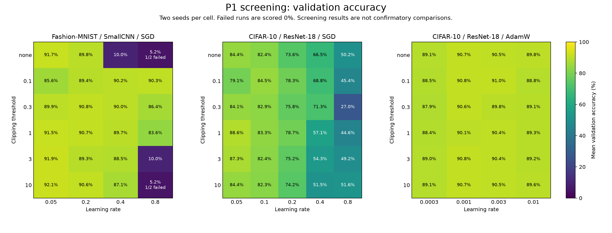

# 节点 30：完整筛选结果与 G1 停止报告

报告日期：2026-10-10（Asia/Shanghai）。实验批次：`lyx_full_20261009_r2`。

**156 组筛选实验全部结束：154 组完成 20 epochs，2 组按预声明失稳规则提前终止。
G1 未通过，因此按冻结协议停止本批实验；P2 因果分支、P3 控制器确认及 P4 迁移均未运行。**
这是当前方案下证据不足与事件稳健性不足的结果，不能解释为整个机制假设已被否定。

## 实际完成范围

| 家族 | 结束 / 计划 | 完整 20 epochs | 预定义失稳终止 | 不良事件总数 |
|---|---:|---:|---:|---:|
| Fashion-MNIST / SmallCNN / SGD | 48 / 48 | 46 | 2 | 14 |
| CIFAR-10 / ResNet-18 / SGD | 60 / 60 | 60 | 0 | 0 |
| CIFAR-10 / ResNet-18 / AdamW | 48 / 48 | 48 | 0 | 0 |
| 总计 | 156 / 156 | 154 | 2 | 14 |

每个配置使用 seeds 0、1；每个学习率包含无裁剪及固定阈值 0.1、0.3、1、3、10。
训练图像数分别为 55,000 和 45,000，均从官方训练集固定留出 5,000 张作为验证集。
本批使用验证集评估，没有使用测试集选择配置。科学源码为 `488032c`，
具体预算、标签、判定门槛及后续条件见 [冻结协议](server30_protocol.md)。

全部训练于 2026-10-10 00:28:02 结束，G1 分析于 00:29:46 结束。
后台进程退出码为 0，进程错误计数为 0，检查时 GPU 计算进程列表为空。

## G1 为什么没有通过

未来风险标签保持冻结定义：未来 1–20 steps 是否出现预声明 loss spike、非有限值
或 loss explosion；先构造完整时序标签，再每 5 steps 取一行。

| 检查 | 实际观察 | 冻结要求 | 判定 |
|---|---|---|---|
| 按种子留出 | 2 个可评估运行；AUPRC 增量均值 −0.000037，探索性区间 [−0.002269, +0.002196] | 至少 10 个含正负标签的运行，均值 ≥ 0.01、区间下界 > 0，三个家族均为正 | 未通过 |
| 按完整配置留出 | 2 个可评估运行；AUPRC 增量均值 −0.031925，探索性区间 [−0.061966, −0.001883] | 同上 | 未通过 |
| 按家族留出 | 无法形成有效的含正负标签运行比较 | 同上，并支持跨家族外推 | 无有效证据 |
| 事件定义稳健性 | 27 / 63 个可评估运行达标，42.86% | 至少 75% 达标 | 未通过 |

预测分析共保留 230,573 行，其中只有 35 行未来标签为阳性。这些行来自 4 个
Fashion-MNIST 运行；两个 CIFAR 家族没有出现预定义不良事件。两个早期终止运行
仍保留已观测的阳性标签，但其短轨迹没有可供单次运行 AUPRC 比较的双类标签。
实际可评估的仅为 Fashion-MNIST、LR 0.8、固定阈值 3 的两个种子。

按家族留出时，留出 Fashion-MNIST 会使训练部分只有阴性；留出 CIFAR 家族时，
验证部分只有阴性。因此该检查无法支持跨家族预测结论。以上区间仅以两个运行
进行探索性 bootstrap，不能当作充分的确认性统计证据。

事件稳健性检查覆盖固定裁剪运行，在 on/off margin 和 dwell 网格下比较事件数。
仅对中位事件数至少为 2 的运行计算相对范围；63 个合格运行中，27 个满足
`(max_count - min_count) / median_count <= 0.5`。未调整阈值来改变判定。

## 失稳、性能退化与标签覆盖是不同现象

两次预定义终止均发生在 Fashion-MNIST、LR 0.8、seed 0：

| 策略 | 完成 steps | 终止 loss | 原因 |
|---|---:|---:|---|
| 无裁剪 | 10 | 2605.40 | loss explosion |
| 固定阈值 10 | 12 | 160.40 | loss explosion |

**没有触发失稳规则不等于训练成功。** 例如，无裁剪 LR 0.4 的两个 Fashion-MNIST
运行完成 20 epochs，却只有 9.54% 和 10.42% 的验证准确率，且不良事件计数均为 0。
这说明本轮标签未覆盖所有接近随机预测水平的性能退化，不能把大量阴性标签理解成
所有配置均处于良好训练状态。这个覆盖限制属于后续新协议需要研究的问题，
没有被事后加入本轮的门槛或标签。

下图对每个配置的两个种子取平均，失稳终止运行记为 0%，避免仅平均幸存种子。
它展示筛选条件下的现象，不替代独立种子的确认比较。



## 工程与证据核验

- G0 的 35 项测试通过，含 CUDA 严格确定性与检查点恢复；6 个真实模型检查通过。
- 156 个运行 ID 唯一，配置摘要逐一与结果匹配；所有摘要均非暂停状态。
- 154 个未提前终止运行的步数与完整训练划分、batch size 128、20 epochs 相符。
- 维修后，科学源码、配置、数据路径与依赖版本均与冻结记录一致。
- 8 个续跑运行的最终日志均为 7,040 行，step 0–7039 连续且无重复。
- 2 个失稳运行的摘要及失败检查点被保留；没有把维修暂停计为科学失败。

可直接复核的仓库文件：

- [156 组结果表](evidence/server30_p1_runs.csv)：参数、步数、验证指标、失稳与不良事件计数。
- [G1 原始数值](evidence/server30_g1.json)：保留门槛结果，移除了服务器内部配置路径。
- [核验摘要](evidence/server30_verification.json)：配置、运行数、标签与事件稳健性计数。
- [运行与存储入口](server30_run_status.md)：服务器完整日志、逐步记录和检查点的位置。

本地证据目录为 `results/server30/final/`，其中压缩归档包含冻结协议、配置、运行摘要、
manifest、G0/G1 报告及完整分析产物；大体积逐步记录和模型检查点保留在服务器。
归档 `lyx_full_20261009_r2_evidence.tar.gz` 的 SHA-256 为：

```text
51f40f003b2ef1a716df81f5c780e9d699573ebbdbaf136a349b87549876a3aa
```

## 结论边界与下一步

本批完成了预定的完整筛选，并在 G1 按规则停止。不能声称已获得时序或优化器位置
的因果证据，也不能声称事件控制器优于基线，因为相应阶段尚未执行。

若后续继续研究，应另立协议，先检验风险标签是否覆盖有研究价值的训练退化、
以及边界条件是否能产生足够的独立含双类标签运行，再冻结定义并用新种子检验。
本报告没有自动启动这类新实验，也没有把当前探索结果改写成通过。
